# Débris spatiaux et syndrome de Kessler : TIPE 2022, version modernisée

> **La multiplication des débris dans l'orbite basse va-t-elle devenir un processus incontrôlable ?**

Ce dépôt reprend mon TIPE de MP (2021-2022, *Modélisation du remplissage de l'orbite basse
terrestre par les débris spatiaux*) et le refait avec les outils actuels :

| | TIPE 2022 | Version 2026 |
|---|---|---|
| Modèle | 2 équations différentielles, une seule « boîte » | 2022 **+** modèle à 36 couches d'altitude × 3 espèces (actifs, abandonnés, débris) |
| Physique | durées de vie sinusoïdales ajustées à la main | traînée atmosphérique (atmosphère exponentielle par morceaux + cycle solaire), théorie cinétique des collisions, *NASA Standard Breakup Model* |
| Résolution | `odeint`, 1 trajectoire | `solve_ivp` (LSODA), **analyse de stabilité**, formule fermée de l'équilibre |
| Hasard | absent | **Monte Carlo** (collisions poissoniennes, 300 histoires) |
| Machine learning | absent | **SINDy** (découverte d'équations) + **réseau de neurones substitut** + **analyse de sensibilité de Sobol** |
| Qualité | scripts copiés-collés | package Python, 20 tests, CI GitHub Actions, figures reproductibles |

---

## 1. Le modèle de 2022, enfin compris

$$
\begin{aligned}
\frac{dN}{dt} &= A(t) - \frac{N}{T_N(t)} - x\,nN - 2yN^2 \\
\frac{dn}{dt} &= \beta A(t) - \frac{n}{T_n(t)} + \alpha x\,nN + \gamma y N^2 - 2 z n^2
\end{aligned}
$$

$N$ : satellites intacts, $n$ : fragments de plus de 1 cm, $A(t) = a + b\sin(ct+d)$ : lancements,
$T_N, T_n$ : durées de vie atmosphériques modulées par le cycle solaire de 11 ans.

En 2022, j'avais observé numériquement que **les populations convergent toujours vers la
même limite** (~1 170 satellites, plusieurs dizaines de millions de fragments), *« peu importe
les conditions initiales »*, sans réussir à l'expliquer (annexe *« Explication de la limite ? »*).

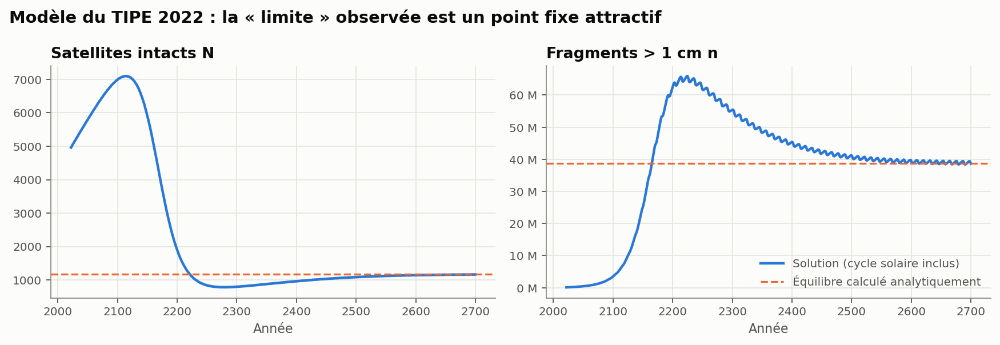

### Explication : un point fixe attractif, calculable à la main

On moyenne les coefficients sur un cycle solaire. La moyenne de $1/T_n$ se calcule exactement :
$\langle 1/(p+q\sin\theta)\rangle = 1/\sqrt{p^2-q^2}$, d'où une durée de vie effective
$\bar T_n = \sqrt{p^2-q^2} \approx 123$ ans, nettement plus courte que la moyenne arithmétique
$p = 185$ ans : ce sont les maxima solaires qui nettoient l'orbite.

On néglige ensuite les termes petits ($y$, $z$, $N/T_N$) :

* $\dot n = 0 \;\Rightarrow\; \alpha x N^* = 1/\bar T_n \;\Rightarrow\; \boxed{N^* = \dfrac{1}{\alpha x \bar T_n} \approx 1\,177}$
* $\dot N = 0 \;\Rightarrow\; A = x n^* N^* \;\Rightarrow\; \boxed{n^* = \alpha\, A\, \bar T_n \approx 3{,}9\times 10^7}$

Interprétation : à l'équilibre, **chaque satellite lancé finit détruit par un fragment** et
devient $\alpha$ fragments, qui vivent $\bar T_n$ ans. Les conditions initiales n'interviennent
nulle part. La racine numérique exacte vaut $N^* = 1\,169$ et $n^* = 3{,}88\times10^7$ (moins de 1 % d'écart).
La jacobienne a deux valeurs propres complexes de partie réelle négative : c'est un **foyer
stable**, avec un temps de relaxation d'environ 74 ans. Cela explique le dépassement puis le
retour vers la limite.

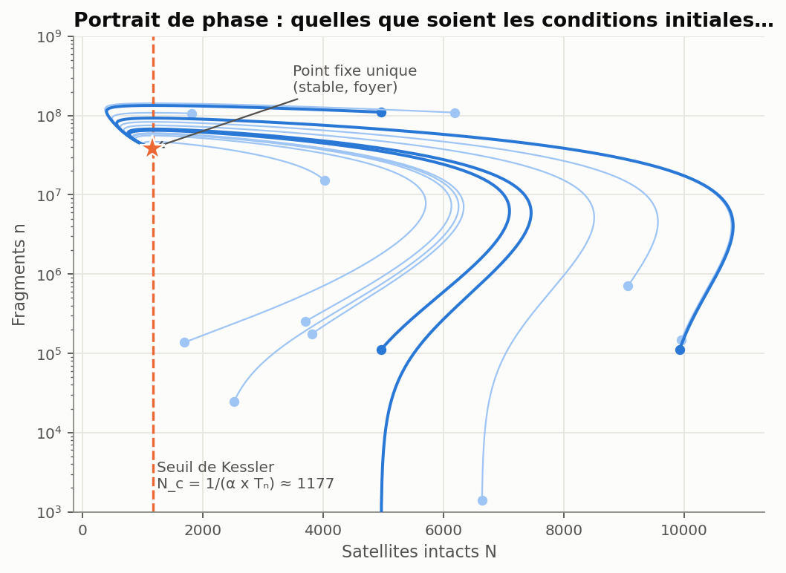

### Le lien avec l'épidémiologie

Le terme $(\alpha x N - 1/T_n)\,n$ est exactement celui d'un modèle **SIR** : les fragments
« infectent » les satellites. Le **nombre de reproduction** $R = \alpha x N \bar T_n$ compte les
fragments engendrés par un fragment pendant sa vie. Le **seuil de Kessler** est $R = 1$,
c'est-à-dire $N_c = 1/(\alpha x \bar T_n)$. En 2022, $R \approx 4{,}2$ : la cascade est
auto-entretenue. La limite de 1 170 satellites est une « immunité collective » : l'orbite ne
peut pas durablement contenir plus de satellites que le seuil.

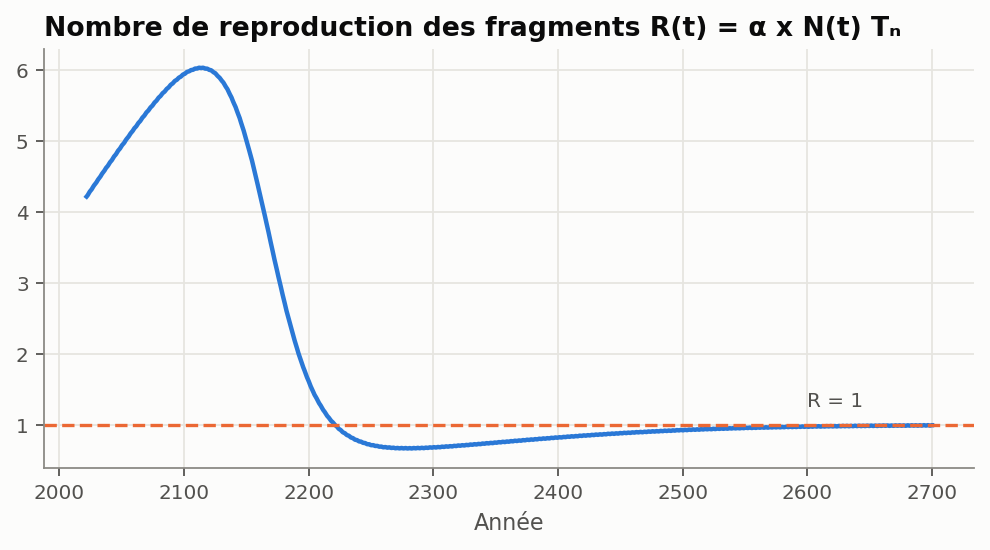

> **Errata 2022.** Le code d'origine contenait `-2*z**2` au lieu de `-2*z*n**2`.
> L'effet est négligeable (moins de 0,04 % d'écart relatif, testé), car les collisions
> fragment-fragment sont minoritaires. Les valeurs maximales diffèrent un peu de celles des
> diapositives (66 M au lieu de 91,5 M), car les scripts retrouvés ne correspondent pas tous
> exactement au jeu de paramètres de la présentation.

**Limite du modèle de 2022 :** 40 millions de fragments de plus de 1 cm, c'est environ 40 fois
plus que les estimations actuelles de l'ESA (de l'ordre du million). Les coefficients
« boîte unique » ne savent pas *où* sont les objets. D'où la suite.

---

## 2. Un modèle moderne : 36 couches d'altitude

Inspiré des modèles *source-sink* actuels (MOCAT-SSEM du MIT), [`src/kessler/shells.py`](src/kessler/shells.py)
découpe l'orbite basse (200-2000 km) en couches de 50 km et suit trois espèces par couche :
**S** (satellites actifs, qui manœuvrent et se désorbitent en fin de vie), **D** (objets
abandonnés) et **N** (débris de plus de 10 cm).

* **Traînée** : $\dot a = -\rho(h)\,B\,\sqrt{\mu r}$, avec l'atmosphère exponentielle par
  morceaux de Vallado. C'est la loi barométrique isotherme de l'annexe de 2022, appliquée bande
  par bande. La densité est modulée par le cycle solaire, et les objets descendent de couche en
  couche jusqu'à la rentrée.
* **Collisions** : théorie cinétique des gaz, taux $\sigma v_{rel}/V$ par paire.
* **Fragmentation** : *NASA Standard Breakup Model*, $N(>L_c) = 0{,}1\,M^{0,75}L_c^{-1,71}$
  (environ 560 débris de plus de 10 cm pour une collision entre deux satellites de 260 kg).
* **Politiques** : taux de désorbitation en fin de vie (PMD), évitement de collisions, retrait
  actif de débris (ADR).

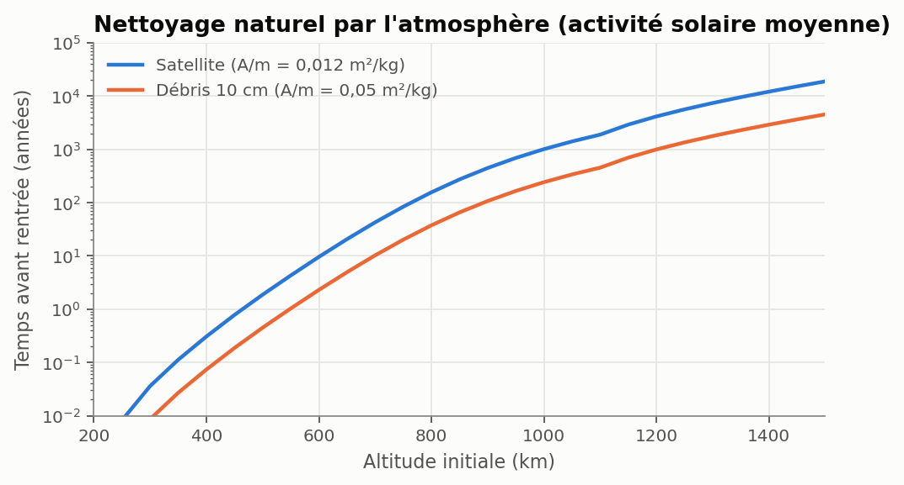

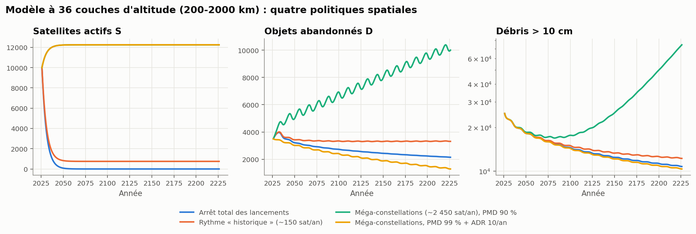

| Scénario (200 ans) | Débris de plus de 10 cm en 2226 | Collisions catastrophiques |
|---|---|---|
| Arrêt total des lancements | 10 700 | 19 |
| Rythme « historique » (~150 sat/an) | 12 200 | 27 |
| Méga-constellations (~2 450 sat/an), PMD 90 % | **74 600 (en hausse)** | **194** |
| Méga-constellations, PMD 99 % + ADR | 10 300 | 23 |

La question de 2022 a donc une réponse plus nuancée. **Ce n'est pas le nombre de satellites
qui compte, mais ce qu'ils deviennent en fin de vie et l'altitude à laquelle ils volent.** À
550 km, l'atmosphère fait le ménage en quelques années. Les débris s'accumulent vers
1 000-1 200 km, où rien ne les freine :

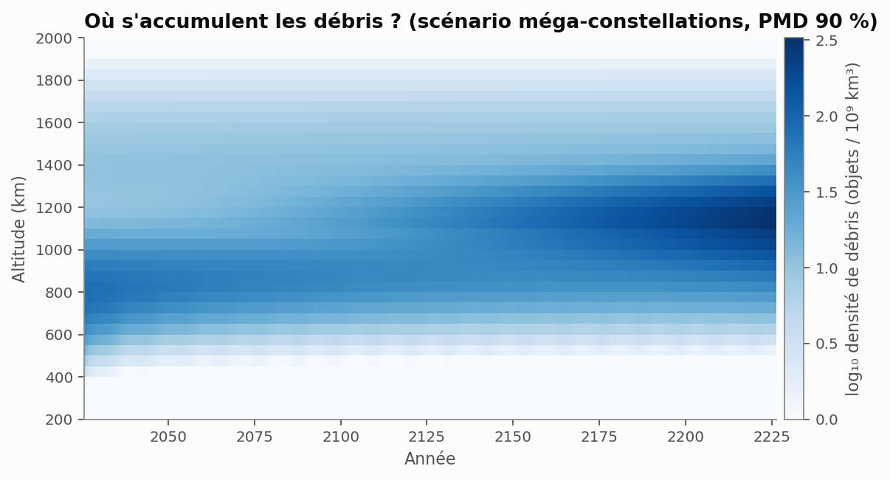

### Monte Carlo : le hasard des collisions

Les collisions catastrophiques sont rares (quelques-unes par décennie) : la date de la prochaine
collision de type *Iridium-Cosmos* compte. [`stochastic.py`](src/kessler/stochastic.py) tire chaque
événement au hasard : collisions selon une **loi de Poisson** (l'idée de départ du TIPE, notée
dans le DOT), rentrées selon une loi binomiale. C'est ainsi que fonctionnent les codes
professionnels (NASA LEGEND, CNES MEDEE). Dans le scénario des méga-constellations, l'intervalle
à 90 % en 2226 va de 60 000 à 92 000 débris.

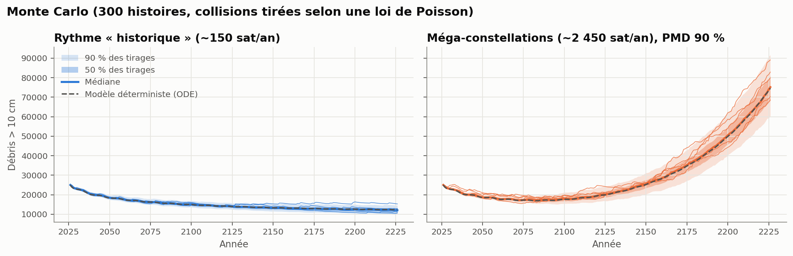

---

## 3. Machine learning

### 3.1 SINDy : une machine peut-elle retrouver les équations ?

*Sparse Identification of Nonlinear Dynamics* (Brunton, Proctor & Kutz, PNAS 2016), réimplémenté
de zéro dans [`ml/sindy.py`](src/kessler/ml/sindy.py). On ne donne à l'algorithme **que des
séries temporelles bruitées** (1 %) de $N(t)$ et $n(t)$, ainsi qu'une bibliothèque de termes
candidats ($1, N, n, N^2, Nn, n^2$). Une régression parcimonieuse (STLSQ) choisit les termes
utiles :

```
dN/dt = +0.03115 - 0.006904 N n        (vrai : 0.03141 - 0.006895 N n)
dn/dt = -0.008131 n + 0.006926 N n     (vrai : -0.008119 n + 0.006895 N n)
```

Les coefficients dominants sont retrouvés à moins de 1 %, et le modèle découvert prédit
correctement une trajectoire jamais vue. Les termes $y$, $z$, $\beta$ et $N/T_N$ ne sont **pas**
retrouvés : ils sont trop petits pour être identifiables dans des données réelles. C'est une
leçon de modélisation. Le TIPE de 2022 avait 17 paramètres, mais les données n'en contraignent
réellement que 4.

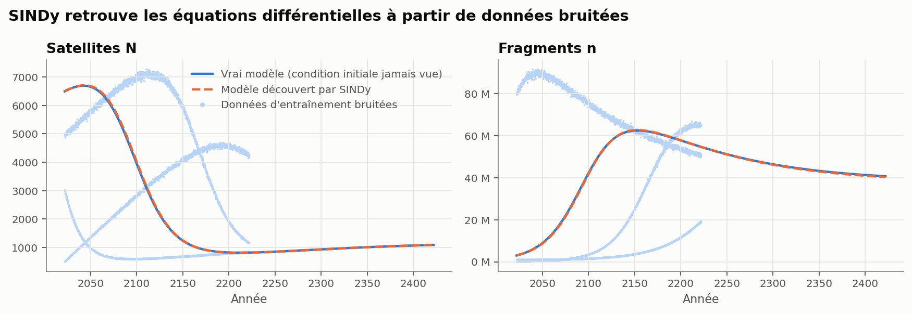

### 3.2 Un réseau de neurones substitut pour explorer 260 000 futurs

Une simulation de 200 ans prend environ 0,5 s. Une analyse d'incertitude sérieuse en demande des
centaines de milliers. On procède donc ainsi ([`ml/surrogate.py`](src/kessler/ml/surrogate.py)) :

1. tirer 1 500 jeux de paramètres (hypercube latin) parmi 6 facteurs incertains ou politiques ;
2. lancer les vraies simulations en parallèle ;
3. entraîner un **réseau de neurones** (MLP 128-128-64) qui prédit le résultat ;
4. le valider sur 300 simulations jamais vues : **R² = 0,9996**.

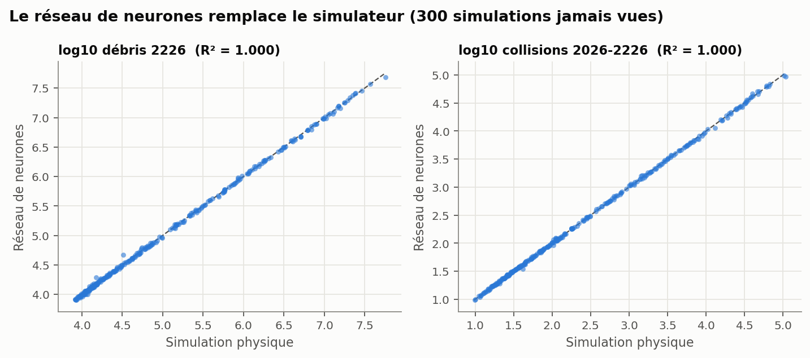

Le réseau donne une réponse en quelques microsecondes. Il permet de calculer les **indices de
Sobol** (part de la variance expliquée par chaque facteur) sur 260 000 évaluations :

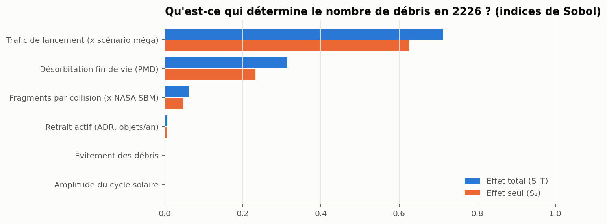

Le trafic de lancement et le taux de désorbitation en fin de vie expliquent à eux seuls près de
90 % de la variance (effets seuls : 63 % et 23 %). L'incertitude sur le modèle de fragmentation pèse environ 6 %. Le retrait
actif (jusqu'à 30 objets/an) et l'amplitude du cycle solaire sont presque sans effet à cet
horizon. Enfin, une **carte de décision** donne le taux de désorbitation nécessaire pour un
trafic donné :

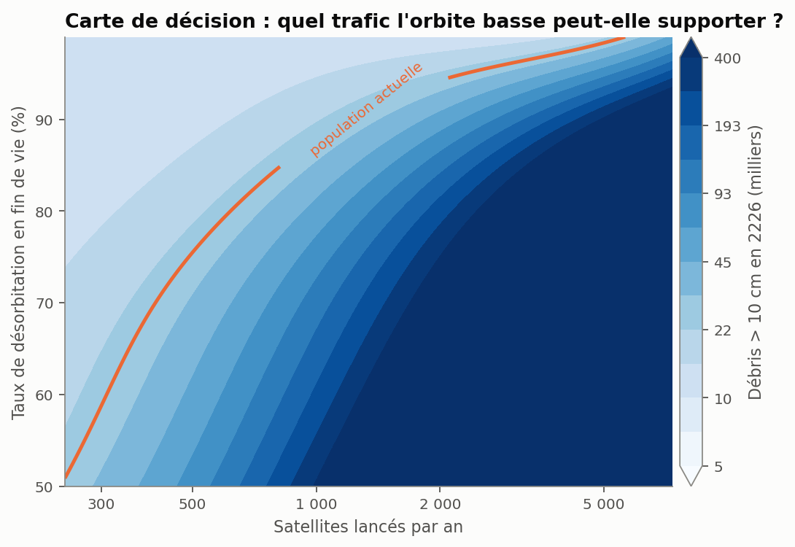

---

## Conclusion

1. Le modèle de 2022 décrit bien un **syndrome de Kessler** : le seuil est franchi ($R > 1$) et
   le système converge vers un équilibre catastrophique indépendant des conditions initiales. On
   sait maintenant pourquoi, et on le calcule en une ligne.
2. Avec plus de physique, la conclusion se nuance : l'orbite basse n'est pas condamnée, mais
   **la discipline en fin de vie (désorbitation à plus de 95-99 %) est la variable de contrôle
   principale**, loin devant le retrait actif à petite échelle.
3. Les données ne permettent de contraindre que quelques mécanismes dominants (SINDy), d'où
   l'intérêt des approches probabilistes (Monte Carlo, Sobol) plutôt que d'une trajectoire unique.

> ⚠️ Les populations initiales (≈ 10 000 actifs, 3 500 abandonnés, 25 000 débris de plus de
> 10 cm) et les scénarios de lancement sont des **ordres de grandeur illustratifs**, pas un
> catalogue calibré. Les tendances et les mécanismes sont robustes, pas les chiffres exacts.

---

## Utilisation

```bash
git clone https://github.com/AntoineGilsonGH/TIPE-Spatial-Debris.git
cd TIPE-Spatial-Debris
python -m venv .venv && source .venv/bin/activate
pip install -e ".[dev]"
pytest -q                      # 20 tests
cd scripts && ./run_all.sh     # régénère toutes les figures (~1 min ; --rebuild : refait les 1 500 simulations, ~5 min)
```

```python
from kessler import tipe_model as tm
tm.analytic_equilibrium()          # (1177.5, 3.87e7)
tm.stability()["eigenvalues"]      # foyer stable

from kessler.shells import ShellParams, simulate_shells
run = simulate_shells(ShellParams(pmd=0.99))
```

## Organisation

```
src/kessler/
  tipe_model.py     modèle 2022 + équilibre, stabilité, seuil de Kessler
  shells.py         modèle multi-couches (traînée, collisions, fragmentation, politiques)
  stochastic.py     Monte Carlo (tau-leaping)
  ml/sindy.py       découverte d'équations (STLSQ)
  ml/surrogate.py   réseau de neurones substitut + indices de Sobol
scripts/            un script par partie, génère figures/
tests/              pytest
data/               jeu de 1 500 simulations (cache du substitut)
legacy/             code Python et présentation d'origine (2022), tels quels
```

## Références

1. D. J. Kessler, B. G. Cour-Palais, *Collision Frequency of Artificial Satellites: The Creation of a Debris Belt*, JGR 83 (A6), 1978.
2. N. L. Johnson et al., *NASA's New Breakup Model of EVOLVE 4.0*, Adv. Space Res. 28 (9), 2001.
3. IADC, *Stability of the Future LEO Environment*, 2013.
4. D. A. Vallado, *Fundamentals of Astrodynamics and Applications*, table 8-4 (atmosphère exponentielle).
5. S. L. Brunton, J. L. Proctor, J. N. Kutz, *Discovering governing equations from data by sparse identification of nonlinear dynamical systems*, PNAS 113, 2016.
6. A. Saltelli et al., *Variance based sensitivity analysis of model output*, Comput. Phys. Commun. 181, 2010.
7. D. Jang, R. Linares et al., *MOCAT: MIT Orbital Capacity Assessment Toolbox* (modèles source-sink multi-couches).
8. J.-C. Dolado-Pérez et al., *Introducing MEDEE – A New Orbital Debris Evolutionary Model*, 2013.
